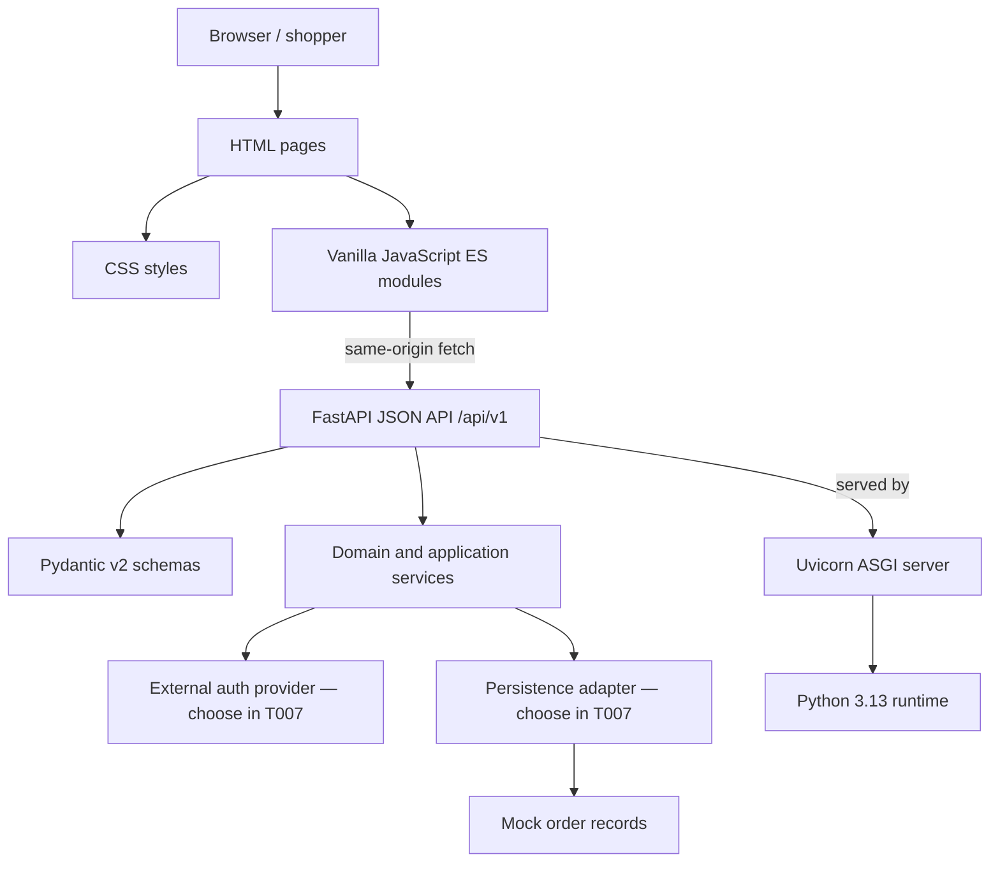

# Nexo Market — Technology Stack

**Decision for T005:** Build the backend with **Python + FastAPI** and the browser UI with **plain HTML, CSS, and JavaScript**. Do not introduce React, Vue, or another UI framework. Keep the frontend build-free unless a later task demonstrates a concrete need for a bundler.

## Runtime and packages

| Area | Selection | Responsibility |
|---|---|---|
| Backend runtime | Python 3.13+ | API and application runtime |
| API framework | FastAPI 0.x, constrained to `<1` | HTTP routes, request validation, OpenAPI docs |
| ASGI server | Uvicorn, `standard` extra, constrained to `<1` | Local and deployed ASGI serving |
| Schema validation | Pydantic v2 (via FastAPI) | Validate API input/output schemas |
| Frontend runtime | Browser-native HTML, CSS, JavaScript (ES modules) | Responsive Romanian storefront and customer flows |
| Frontend tooling | None required at runtime; no npm dependencies initially | Static asset authoring and optional Node-based scripts only |

Use a Python virtual environment and declare backend dependencies in `pyproject.toml`; pin the resolved dependency set in a lock file when bootstrapping (T010). Node 26 is optional developer tooling, not a production dependency. No dependencies are installed as part of this decision task.

## Application shape

- FastAPI owns the same-origin `/api/v1/` JSON API and serves frontend files from a static directory. This keeps local development simple and avoids CORS configuration for the first prototype.
- The UI uses semantic HTML documents, shared CSS, and small JavaScript ES modules calling the API with `fetch`. Keep money calculations and order validation authoritative on the backend; the UI may display previews.
- Keep routes, domain schemas, and persistence behind separate backend modules so the selected authentication provider and persistence service (T007) can be integrated without coupling them to page markup.
- Authentication is a real provider-backed flow per the spec. Provider selection and client/server integration are intentionally left to T007; never implement password storage or treat a mock sign-in as real authentication.
- Payment remains a non-transactional mock state. Do not collect card details or add a payment SDK.

## Local run/build approach

1. Create and activate a Python 3.13 virtual environment.
2. Install the project dependencies from the project manifest/lock file once T010 adds them.
3. Start the app with `uvicorn app.main:app --reload` (module path can be finalized in T010).
4. Open the local FastAPI origin; it serves the HTML/CSS/JS and API together. FastAPI's OpenAPI page is available at `/docs` during development.
5. There is no frontend compilation step. If frontend tooling is later added, keep it optional and document its reason and output directory.

## Technology dependency tree

## Decision boundaries and follow-on work

- T006 should define the concrete page/route map without changing this framework split.
- T007 must choose auth and persistence services and document their SDK/deployment requirements; changes there affect configuration (T009), auth setup (T019–T025), and order access/storage (T028–T029, T050–T055).
- T008 defines visual tokens and responsive conventions for the plain CSS implementation.
- T010 creates the project layout and actual dependency lock. Keep the API prefix, Python package name, and static directory consistent with this document or update this decision record alongside the implementation.

## References

- [FastAPI documentation](https://fastapi.tiangolo.com/)
- [FastAPI release notes](https://fastapi.tiangolo.com/release-notes/)
- [Node.js release status](https://nodejs.org/en/about/previous-releases) — Node 26 is Current as of this decision date; it is optional tooling only.
